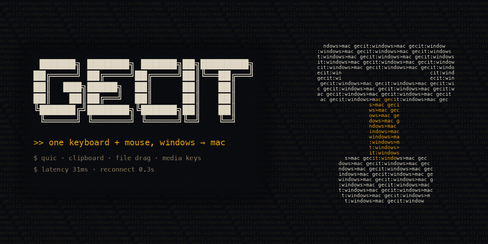

# Gecit

Push the pointer off the edge of your PC screen and it lands on your Mac. Type, copy, paste, drag files. Push it back and you are on Windows again.

Gecit is a small native app on each side. The keyboard and mouse stay plugged into the Windows PC, and the Mac sits next to it: below, above, left or right, slid along that edge the way you arrange displays in macOS.

Website: https://kasparovabi.github.io/gecit/

## What it does

- Keyboard and mouse cross to the Mac at the screen edge that faces it, and come back the same way. Keys travel as physical scan codes, so your layout is the same on both sides.
- The clipboard works both ways, for text and images.
- Media keys (volume, mute, play, next) control the Mac while the pointer is there.
- With Gecit Pro you can drag files from Windows to the Mac and back.
- If Wi-Fi hiccups, Gecit reconnects in a fraction of a second. If the Mac goes quiet, the pointer returns to Windows on its own.
- Everything stays between your two computers on your local network. There is no account and no cloud, and nothing is tracked.

## Requirements

- A Mac with Apple silicon, running macOS 13 Ventura or later.
- A 64-bit PC running Windows 10 (version 2004 or later) or Windows 11.
- Both on the same local network. Gecit uses UDP port 24800.

## Download

- **Mac:** `Gecit.zip` from the [latest release](https://github.com/kasparovabi/gecit/releases/latest). The app is signed and notarized by Apple.
- **Windows:** [Gecit in the Microsoft Store](https://apps.microsoft.com/detail/9NSSWCBJXD8S) is the recommended way to install; the Store keeps it up to date. On PCs without the Store, use `gecit.exe` from the [latest release](https://github.com/kasparovabi/gecit/releases/latest). It is not code-signed yet, so SmartScreen shows "Windows protected your PC" the first time: click "More info", then "Run anyway". On PCs with Smart App Control turned on, Windows will not open it at all; use the Store version there.

## Setup

**Windows.** Double-click `gecit.exe` and choose Install. Windows asks for administrator permission once. Gecit copies itself to Program Files, starts at sign-in, adds a firewall rule for itself, and shows a pairing window with a 6-digit code. Its icon sits in the notification area.

**Mac.** Open `Gecit.zip` and double-click `Gecit.app`. It offers to move itself to Applications, then asks for two things: permission to run in the background (System Settings > General > Login Items) and Accessibility access, which it needs to move the pointer and type for you. Gecit lives in the menu bar.

**Pairing.** The Mac lists the Gecit PCs on your network. Pick yours, type the code shown on the PC, and press Pair. From then on the two connect only to each other, using certificates they exchanged while pairing. If the PC does not show up in the list (guest Wi-Fi, VPN), choose "Other PC" and type the address from the PC's pairing window.

**Screen arrangement.** Open "Screen arrangement…" from the Mac menu while connected, and drag the Mac box to the edge where your Mac really sits.

Coming from Input Leap or Barrier? Quit it on both computers first, because two programs cannot capture the keyboard at the same time.

## Updates

The Mac app and the downloaded Windows app check this repository for a new release shortly after they start and then once a day. The request carries no identifier and does not say which version you run. A new version is offered in the menu, and nothing is downloaded until you click. Every release is signed, and Gecit refuses an update whose signature or checksum does not match. You can turn the check off with `"update_check": false` in `config.json` on each computer. The Microsoft Store version is updated by the Store and never checks this repository.

Keep both computers on the same version. When one side is newer, its menu reminds you to update the other.

## Gecit Pro

Keyboard, mouse, clipboard and media keys are free. Dragging files between Windows and the Mac needs Gecit Pro, a one-time purchase of $9.99 through Lemon Squeezy. A license works on up to two Macs at a time. Buy it from the [website](https://kasparovabi.github.io/gecit/#buy) or from "File drag: Gecit Pro ($9.99)…" in the Mac menu, then paste the key from your receipt into "Enter license key…". Launch offer until 17 November 2026: 50% off with the code LAUNCH50, which the website's Buy button applies for you.

If Gecit Pro does not work for you, email within 14 days of purchase for a full refund.

## Privacy

Keystrokes, mouse movement, clipboard contents and dragged files go only between your own two computers, directly over your network. With Gecit Pro, the Mac sends your license key and an activation ID to Lemon Squeezy at activation and about once a week. Apart from those calls and the update check, Gecit sends nothing anywhere. The full policy is on the [website](https://kasparovabi.github.io/gecit/#legal).

## Support

Questions, bugs, lost license keys: kasparovabi@gmail.com. Please attach the logs if something breaks:

- Mac: `~/Library/Application Support/Gecit/gecit.log`
- Windows: `%APPDATA%\Gecit\gecit.log` and `%APPDATA%\Gecit\setup.log`

## Uninstall

- **Windows:** Settings > Apps > Installed apps > Gecit > Uninstall.
- **Mac:** choose Quit in the Gecit menu, then drag `Gecit.app` from Applications to the Trash.

Pairing and settings stay behind so a reinstall does not need a new pairing. To remove them too, delete `%APPDATA%\Gecit` on Windows and `~/Library/Application Support/Gecit` on the Mac.

---

Gecit is closed-source software by snthbob. This repository holds the releases and this page. © 2026 snthbob. All rights reserved.
